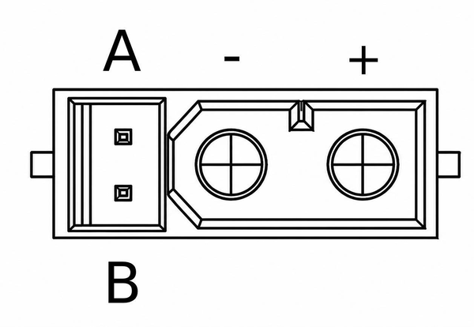

# g1motor

Unofficial drivers for the joint motors of the Unitree G1 on their RS-485 bus, in Python, C++
and MATLAB, with a description of the communication protocol. Reverse engineered from bus
captures and bench tests; not affiliated with or supported by Unitree.

Use the drivers on a bare arm or motor with no robot controller on the bus. On a complete robot
the onboard controller is the bus master; the drivers refuse to open a bus that has traffic.

## Start here

1. Read [Wiring](#wiring) and [Serial port](#serial-port) before connecting hardware.
   These drivers are for a bare arm or motor with the robot controller disconnected.
2. Install one interface: [Python](python/README.md), [C++](cpp/README.md), or
   [MATLAB](matlab/README.md). Each guide gives build, scan, and test commands.
3. Scan the isolated bus to find its motor IDs. A scan sends idle frames; it is
   **not passive monitoring** and can interrupt an existing hold.
4. Try zero torque before a position hold. Enabling a motor frees the joint;
   support any load before enabling it. The examples use gains tested on a
   24 V bench wrist, not gains validated for every G1 joint.

For packet layouts and reverse-engineering results, read the
[English protocol guide](docs/G1_Joint_Motor_Protocol_Guide.pdf) or
[Chinese protocol guide](docs/G1_Joint_Motor_Protocol_Guide_zh.pdf).
The [lab notes](docs/lab_notes.md) preserve the experiments in order; early
hypotheses may be superseded by later measurements.

## Layout

| Folder | Contents |
|---|---|
| `docs/` | The communication protocol: `G1_Joint_Motor_Protocol_Guide.pdf` (English) and `_zh.pdf` (Chinese), their sources, lab notes, and the Doxygen configuration |
| `python/` | `g1motor` for Python |
| `cpp/` | `g1motor` for C++17 |
| `matlab/` | `g1motor` for MATLAB (calls the C++ library through a MEX file) |

Each language folder has the same four parts:

| Part | Python | C++ | MATLAB |
|---|---|---|---|
| Library | `python/g1motor/` | `cpp/g1motor/` | `matlab/+g1motor/` |
| Tests | `python/tests/` | `cpp/tests/` | `matlab/tests/` |
| Examples | `python/examples/` | `cpp/examples/` | `matlab/examples/` |
| Build | `pyproject.toml` | `CMakeLists.txt` | `build_mex.m` |

and the same names inside: the library is split into `protocol`, `serial_port`, `motor_bus`,
`joint` and `units`; the tests are `protocol_test`, `joint_test` and `hardware_test`; the examples
are `scan`, `zero_torque`, `position_hold` and `sine`. (`python/tools` additionally holds the
research scripts used to reverse engineer the bus.)

## Wiring

The G1 joint motors use the same RS-485 accessory kit as Unitree's other motors. The photo is
from Unitree's [Motor SDK accessory kit](https://support.unitree.com/home/en/Motor_SDK_Dev_Guide/accessoryKit)
page (it shows a GO1/B1 motor; a G1 joint plugs in the same way).

*Image: Unitree Robotics.*

From left to right:

| Part | Photo label | Connects |
|---|---|---|
| USB to RS-485 module | USB转485模块 | USB to the computer |
| 3-pin cable | 3P 成品线 | USB module to the power module |
| Power to RS-485 module | 电源转485模块 | Joins the RS-485 pair with the supply; the XT30 input takes the external supply (XT30用户外部供电) |
| No. 9 cable | 9号成品线 | Power module to the motor |
| XT30(2+2) plug | XT30(2+2)连接 | The motor: two power pins and the two RS-485 lines |

The motor's XT30(2+2) connector, from Unitree's
[Motor SDK overview](https://support.unitree.com/home/en/Motor_SDK_Dev_Guide/about):

*Image: Unitree Robotics.* RS-485 `A` and `B` on the signal side; supply `-` and `+` on the
power side.

**Supply.** Everything in this repository was tested on a **24 V** bench supply. On the robot
the bus runs at about 48 V. On 24 V:

- The motors top out at about 1,275,000 position counts/s (about 39 rotor turns/s), whatever is
  commanded.
- Braking hard from top speed can pull the supply down to about 15 V and latch the
  under-voltage fault (status `0x8`). Later bench tests cleared it with mode 7
  (`restart()`); a power cycle also cleared it. Stop by going to idle (`disable()`),
  which does not cause the fault. See the
  [bench results](docs/lab_notes.md#stopping-from-top-speed-three-ways-compared-2026-11-25).

Keep the robot's own controller off the bus. Power on the motors only after you have checked the
wiring, and keep the joint clear of anything it could hit.

## One API in three languages

| | Python | C++ | MATLAB |
|---|---|---|---|
| Open | `bus = g1motor.MotorBus()` | `g1motor::MotorBus bus;` | `bus = g1motor.MotorBus();` |
| Find motors | `bus.scan()` | `bus.scan()` | `bus.scan()` |
| Run mode, zero torque | `bus.enable([4, 5, 6])` | `bus.enable({4, 5, 6})` | `bus.enable([4 5 6])` |
| Command | `bus.command(4, pos, 0, 0, 300, 40)` | `bus.command(4, pos, 0, 0, 300, 40)` | `bus.command(4, pos, 0, 0, 300, 40)` |
| Stop (idle brakes the joint) | `bus.disable()` | `bus.disable()` | `bus.disable()` |
| Clear a fault | `bus.restart([4])` | `bus.restart({4})` | `bus.restart(4)` |
| Joint angle | `bus.joint(4).angle(pos)` | `bus.joint(4).angle(pos)` | `bus.joint(4).angle(pos)` |
| Checksum | `g1motor.crc32_core(data)` | `g1motor::crc32_core(data, len)` | `g1motor.crc32_core(data)` |
| Constant | `g1motor.BAUD` | `g1motor::BAUD` | `g1motor.BAUD` |

`command(id, pos, vel, tau, kp, kd)` takes raw protocol values, not degrees,
radians, or N·m. `pos` is a rotor position target, `vel` a rotor velocity target,
`tau` feed-forward torque, and `kp` / `kd` the position / damping gains.
`units` converts rotor values; an attached `Joint` converts output-shaft angles
using its gear ratio and software zero. The torque conversion scale is assumed,
not measured. See each language guide for the full API.

`enable()` enters run mode with zero torque; `disable()` enters idle with passive
braking. Neither is a position hold. Poll **every enabled motor** in the command
loop; after about 0.5–1 s without polling, a motor drops to idle. `read()` also
sends a command: on an enabled motor it replaces the hold with zero torque.
Use the state returned by `command()` when maintaining a hold.

## Naming

One rule in all three languages: functions, methods and variables are `snake_case`, types are
`PascalCase`, constants are `UPPER_CASE`, files are `snake_case` (a MATLAB class file is named after
its class). This is the Google Python style. C++ follows the Google C++ guide in everything else
(include guards, trailing underscore on class members, `clang-format`); its function and constant
names follow the common rule instead, so that the three interfaces read the same.

## Tests

Build or install the selected interface first, following its linked guide.
Run the commands below from the repository root, except for the MATLAB functions.

Each language has two tests that need no hardware and one that needs motors on a bus without a
controller (it holds the joints in place for 2 s and restarts one motor).

| | `protocol_test`, `joint_test` | `hardware_test` |
|---|---|---|
| Python | `python -m pytest python` | `python python/tests/hardware_test.py` |
| C++ | `ctest --test-dir cpp/build` | `cpp/build/hardware_test` |
| MATLAB | `protocol_test`, `joint_test` (in `matlab/tests`) | `hardware_test` (in `matlab/tests`) |

## Documentation

- **Protocol:** `docs/G1_Joint_Motor_Protocol_Guide.pdf`. Rebuild with `sh docs/manual/build.sh` (Python 3, `google-chrome-stable`, and
  Poppler’s `pdfinfo` must be on `PATH`). The English source is
  [manual.html](docs/manual/manual.html); `make_zh.py` generates the Chinese HTML.
- **API reference:** every class and function carries Doxygen comments. Build it with
  `doxygen docs/Doxyfile` from the top of the repository; open `docs/api/html/index.html`.
  MATLAB files are read through `docs/doxygen_matlab_filter.py`.

## Serial port

The bus runs at 6,000,000 baud, a non-standard rate. No general serial library is used for C++;
`cpp/g1motor/serial_port.cc` calls each operating system's own interface.

| System | Method | Status |
|---|---|---|
| Linux | `termios2` with `BOTHER` (`TCSETS2`), FTDI low-latency flag | run on hardware in all three languages |
| Windows | Win32 `CreateFile` / `DCB.BaudRate` | written, never compiled or run |
| macOS | `termios` + `IOSSIOSPEED` | written, never compiled or run |

- Python uses `pyserial`; on Linux the rate is set with the same `TCSETS2` call because pyserial's
  own custom-rate path fails on glibc 2.42 and later ([pyserial issue 805](https://github.com/pyserial/pyserial/issues/805)).
- Apple's built-in FTDI driver is reported to stop at about 3 Mbaud
  ([Apple forum](https://developer.apple.com/forums/thread/771291)). If macOS refuses 6 Mbaud, the
  options are FTDI's own VCP driver or a backend that talks to the chip directly (FTDI D2XX,
  libftdi, pyftdi); none is implemented here.
- An FTDI FT232H RS-485 adapter is needed (the Unitree one works). Its latency timer limits the
  polling rate: set to 1 ms automatically on Linux, by hand on Windows (Device Manager, the COM
  port, Port Settings, Advanced). At 1 ms all three interfaces reach about 330 exchanges per
  second per motor with three motors; the robot's own controller does about 1,313.

## License

MIT; see [`LICENSE`](LICENSE). Unitree and G1 are trademarks of Unitree Robotics, which neither
endorses nor supports this project.
